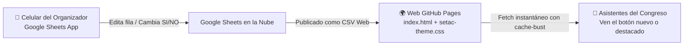

# Plan Estratégico: Control Remoto de Botones y Avisos en Vivo (Congreso SETAC 2026)

## 1. Visión General y Objetivo
Durante el transcurso del congreso (del 27 al 30 de octubre), la necesidad de agregar enlaces imprevistos, avisar cambios de sala o destacar actividades del momento (ej. "Votación de Premios Habilitada", "Cena de Camaradería", "Preguntas en Vivo") debe resolverse **en menos de 1 minuto desde el teléfono móvil**, sin depender de abrir una laptop, escribir código HTML ni esperar compilaciones de Git.

---

## 2. Estructura de la Planilla de Control (Google Sheets)

Se creará una planilla de cálculo en tu Google Drive con **dos pestañas simples**:

### Pestaña 1: `Avisos` (Control del Banner de Alerta)
Controla el cuadro de aviso superior `#liveAlert` en `index.html`:

| Campo | Ejemplo | Descripción |
| :--- | :--- | :--- |
| **activo** | `SI` / `NO` | Si es `SI`, el banner se muestra; si es `NO`, se oculta. |
| **tipo** | `alerta` / `exito` / `info` | Define el color del borde e ícono (amarillo advertencia, verde éxito, celeste institucional). |
| **titulo** | `Aviso Importante` | Encabezado en negrita del banner. |
| **mensaje** | `Acreditaciones habilitadas en Hall Central.` | Texto explicativo del aviso. |

---

### Pestaña 2: `Botones` (Control y Creación de Enlaces)
Permite tanto **controlar botones existentes** como **generar nuevos botones al instante**:

| Columna | Tipo / Valores | Función |
| :--- | :--- | :--- |
| **id** | Texto (ej: `votacion_premios`, `cena`, `preguntas_vistas`) | Identificador único. Si coincide con un botón existente en el HTML, lo modifica. Si es nuevo, lo crea. |
| **activo** | `SI` / `NO` | Muestra u oculta el botón en la página. |
| **posicion** | `arriba` / `destacados` / `sociales` / `abajo` | Dónde se ubica (ej. `arriba` lo pone inmediatamente bajo la tarjeta WiFi). |
| **titulo** | Texto (ej: `🗳️ VOTACIÓN DE PREMIOS 2026`) | Título principal en mayúsculas del botón. |
| **descripcion** | Texto (ej: `Calificá los mejores pósters y ponencias orales`) | Subtexto descriptivo del botón. |
| **url** | Enlace (ej: `https://forms.gle/...`) | URL de destino (abre en pestaña nueva automáticamente). |
| **destacado** | `SI` / `NO` | Si es `SI`, aplica fondo resaltado de alto contraste. |
| **estilo_color** | `dorado` / `celeste` / `verde` / `normal` | Color del botón o de su marco resaltado. |
| **badge_texto** | Texto (ej: `EN VIVO`, `¡HOY!`, `URGENTE`, vació) | Pastilla flotante con pulso animado. |
| **badge_color** | `verde` / `dorado` / `celeste` | Color de la pastilla animada (`pulse-dot`). |
| **icono** | `urna` / `estrella` / `mensaje` / `cubiertos` / `link` | Ícono SVG representativo automático. |

---

## 3. Resiliencia y Comportamiento "Offline / Fallback"
Para garantizar que la web **nunca quede en blanco ni falle** si la conexión a internet en el centro de convenciones se satura:

1. **HTML Base Autocontenido**: Los botones críticos del congreso (Cronograma General, Buscador Interactivo, Programa PDF, Libro de Resúmenes, Mail) ya están escritos en el código estático de `index.html`.
2. **Carga Asíncrona No Bloqueante**: La lectura de la planilla de Google se ejecuta en segundo plano (`fetch` con `AbortController` y timeout de 4 segundos). Si la planilla no responde o hay lentitud, el sitio muestra inmediatamente los botones estáticos de fábrica.
3. **Cache Busting Dinámico**: Se añade un parámetro `?t=` con la marca de tiempo de los últimos 60 segundos para evitar que los navegadores móviles retengan versiones viejas de la planilla.

---

## 4. Tipos de Énfasis y Destacados Visuales
Aprovechando los estilos CSS ya testeados en `setac-theme.css`:

1. **Énfasis de Acción Inmediata (Pastilla Pulso `LIVE`)**:
   - Etiqueta pequeña superior derecha: `🟢 EN VIVO`, `🟠 HOY`, o `⭐ DESTACADO`.
   - Incluye animación CSS de pulso continuo (`pulseLiveDot`) que atrae la vista sin ser invasiva.
2. **Énfasis Festivo / Especial (`btn-accent-festivo`)**:
   - Gradiente ámbar suave con bordes dorados, diseñado para actividades especiales como la Cena de Camaradería o entrega de premios.
3. **Énfasis Primario (`btn-primary-highlight`)**:
   - Celeste de alto impacto con relieve y sombras profundas, ideal para llamados de atención clave.

---

## 5. Plan de Ejecución Técnico (Paso a Paso)

### Fase 1: Creación de la Planilla Maestra (Google Drive)
1. Crear una planilla en tu Google Drive llamada `SETAC_2026_Control_App`.
2. Configurar las columnas exactas en la pestaña `Avisos` y en la pestaña `Botones` con ejemplos pre-cargados.
3. Hacer clic en `Archivo > Compartir > Publicar en la web > Formato CSV (Valores separados por comas)`.
4. Obtener el enlace público CSV.

### Fase 2: Implementación en el Código Frontend (`d_LittleLink`)
1. **Contenedor Dinámico**: Insertar `

` en `index.html` para alojar los botones urgentes/destacados en la parte superior.
2. **Script de Sincronización Ligero (`js/remote_config.js`)**:
   - Parser ultra-liviano de CSV (sin librerías externas).
   - Actualización reactiva del DOM: modifica el banner `#liveAlert`, oculta/muestra botones existentes por `id`, y renderiza nuevos botones dinámicos con los estilos oficiales de `btn-congress`.
3. **Prueba local**: Simular cambio de estado en la planilla y verificar que el cambio se refleje en el navegador al recargar.

### Fase 3: Despliegue en GitHub Pages
1. Confirmar cambios con `git commit` y `git push origin main`.
2. Verificar la URL oficial en producción: `https://setac-arg.github.io/setac-2026/`.
3. Guardar el enlace de la planilla de Google en los accesos rápidos o favoritos del celular para operar durante el evento.

---

## 6. Procedimiento Operativo Durante el Congreso (Cheat Sheet para el Teléfono)

* **Para dar un aviso urgente**: Abrís Google Sheets en tu celular $\to$ Pestaña `Avisos` $\to$ Ponés `activo = SI`, escribís el texto $\to$ Guardás. En 10 segundos cualquier asistente que abra la web verá la alerta.
* **Para destacar un botón**: Pestaña `Botones` $\to$ Buscás la fila $\to$ En `badge_texto` ponés `EN VIVO` o `HOY` $\to$ En `destacado` ponés `SI`.
* **Para agregar un botón nuevo que nadie tenía previsto**: Agregás una fila al final $\to$ Ponés Título, Enlace, y `activo = SI` $\to$ Listo.
